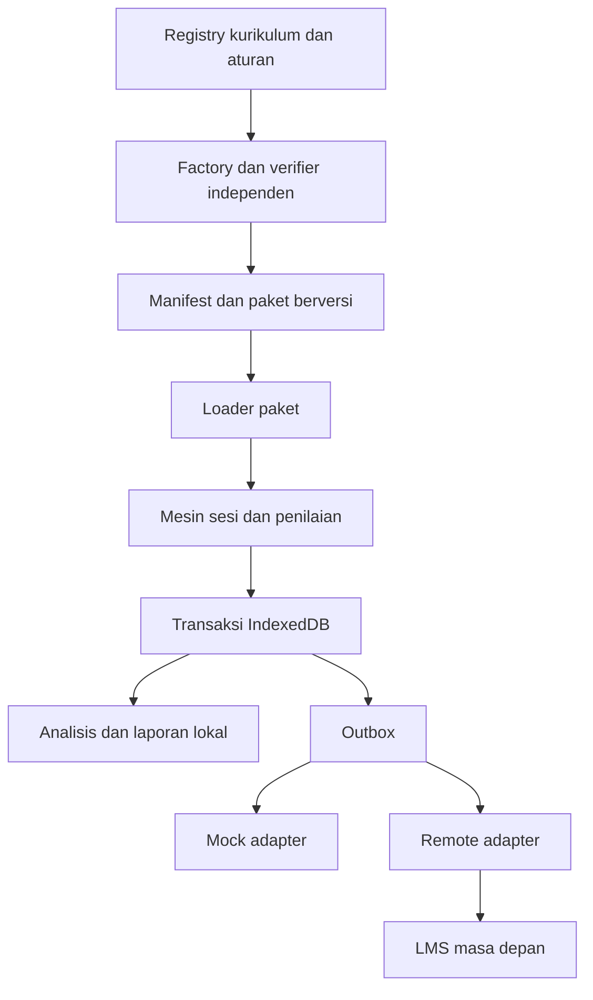

# 04 — Arsitektur website statis dan sambungan LMS KALIBATAKU

**Versi arahan:** 1.0 · **Tanggal:** 25 November 2026 · **Status:** spesifikasi implementasi yang harus diwujudkan dan dibuktikan oleh pembangun website.

Dokumen ini menetapkan keputusan teknis untuk PRD. Sumber akademik adalah Master Curriculum dan Curriculum Registry yang disertakan, berikut daftar koreksi yang dinyatakan di paket ini. Contoh kontrak dalam dokumen ini bersifat penjelasan; berkas schema dan keputusan PRD yang disertakan menjadi acuan field final. Tidak ada website atau server produksi yang dinyatakan selesai oleh dokumen ini.

## 1. Dua batas rilis yang dapat diuji

KALIBATAKU menghasilkan website statis dengan latihan nyata, bank soal lengkap, progres lokal, analisis dan ekspor yang bekerja. Situs juga menyediakan lingkungan simulasi guru/admin untuk menguji seluruh alur akademik sebelum integrasi LMS. Nilai simulasi dan hasil latihan lokal mempunyai asal data dan status kepercayaan yang terlihat.

| Ruang lingkup | Harus bekerja pada rilis statis | Baru sah setelah LMS tersedia |
|---|---|---|
| Latihan siswa | Lima mode, bank soal sesuai kurikulum, jawaban numerik, hasil dan riwayat lokal | Penugasan yang diotorisasi server dan riwayat antarperangkat |
| Analisis | Perhitungan deterministik dari data lokal; demo sintetis terpisah | Agregasi institusi dengan data server yang tervalidasi |
| Guru/admin | Simulasi kelas, assignment, filter, catatan dan ekspor berbasis dataset demo | Akun, izin, roster, monitoring siswa aktual, audit server |
| Laporan | Laporan latihan pribadi berlabel lokal; laporan demo berlabel simulasi | Laporan institusi dengan sumber data, otorisasi dan verifikasi server |
| Bridge | Interface, outbox, simulator ACK/error, remote adapter dan tes kontrak | Koneksi server nyata, autentikasi dan uji integrasi end-to-end |
| Penyimpanan | Browser dan cadangan JSON yang diunduh pengguna | Database, backup institusi, retensi dan pemulihan terpusat |

Dua batas rilis tersebut dilaporkan pada `RELEASE_STATUS.json` melalui field canonical PRD: `static_application`, `bank_content`, `bridge_contract`, `live_lms`, `pedagogical_calibration`, dan `live_deployment`. Lulus rilis statis tidak mengubah status LMS menjadi lulus; LMS yang ditunda oleh lingkup memakai `DEFERRED_BY_SCOPE`. Istilah *LMS-ready* berarti kontrak dan adapter sudah dapat diuji; istilah itu tidak berarti server telah berjalan.

## 2. Stack dan bentuk hasil akhir

Keputusan dasar: **TypeScript, Vite, HTML semantik, CSS dengan design tokens, bank ES module statis, IndexedDB, dan dedicated Web Worker untuk pekerjaan berat**. Framework antarmuka ringan boleh digunakan bila pembangun membuktikan manfaat dan anggaran muat tetap tercapai. Hindari menambahkan SSR, database server, API berbayar, layanan AI, autentikasi semu atau framework full-stack sebagai prasyarat latihan.

Vite dipakai pada saat pengembangan/build; hasil `dist/` adalah aset yang dilayani hosting statis. Dokumentasi Vite menyatakan hasil `vite build` sesuai untuk static hosting; kebutuhan browser aktual harus ditetapkan pada implementasi karena transformasi sintaks tidak otomatis menyediakan semua polyfill. [A01]

Pilih versi dependensi yang didukung ketika implementasi dimulai, kunci versi melalui lockfile dan `.nvmrc`/mekanisme versi setara, lalu catat Node dan package manager dalam bukti build. Jangan menuliskan versi “terbaru” tanpa nomor pada laporan rilis. Gunakan hanya dependensi yang benar-benar dipakai, dilisensikan, dan dapat disertakan pada hasil build. Font dan ikon harus dibundel lokal agar latihan tidak bergantung CDN pihak ketiga.

Satu repository memuat source dan factory. Satu ZIP rilis memuat source, dist, dokumentasi, serta bukti. `node_modules/`, credential, data siswa asli, dan cache developer tidak ikut didistribusikan. Build ulang harus menghasilkan bank dan aset fungsional yang sama. Timestamp artefak atau ZIP yang memang nondeterministik dipisahkan dari hash konten deterministik.

## 3. Batas antarmodul

| Modul | Input dan output utama | Tanggung jawab |
|---|---|---|
| Curriculum catalog | Registry → kelas, level, kompetensi, prasyarat | Menampilkan 60 level dan status aktif/nonaktif secara konsisten |
| Factory | Template, constraint, seed → butir dan paket | Produksi saat build; cakupan, distribusi, solusi dan provenance |
| Content loader | ID paket/versi → data tervalidasi | Memuat hanya aset terdaftar, retry dan mismatch versi |
| Session engine | Konfigurasi + paket → state sesi | Navigasi, draft, submit, retry, hint, timer dan finalisasi |
| Arithmetic core | AST/nilai rasional → hasil eksak | Empat operasi, normalisasi pecahan, batas sumber daya |
| Numeric parser | Teks + locale → nilai atau error format | Tidak menjalankan kode dan tidak menilai error format sebagai salah |
| Event store | Transaksi → ledger lokal append-only | Atomisitas jawaban, event, outbox dan snapshot sesi |
| Analytics | Ledger + policy version → metrik | Agregasi murni yang dapat dihitung ulang |
| Recommendation | Bukti + prasyarat → alasan/rute | Aturan transparan, sampel memadai, tidak menebak kecerdasan |
| Report renderer | Snapshot metrik → berkas | Tabel, narasi, bahasa dan status sumber konsisten |
| Bridge | Event/version → ACK/error terstruktur | Transport, idempotensi, antrean dan otorisasi masa depan |
| UI | State domain → tampilan | Locale, tema, fokus, aksesibilitas dan interaksi |

Antarmuka tidak menghitung skor melalui string tampilan atau teks terjemahan. Mesin domain tidak mengakses DOM. Analytics membaca ledger; menghapus cache grafik tidak boleh menghapus hasil siswa. Generator build tidak ikut initial bundle browser.

## 4. Bank soal ES module yang benar-benar dimuat sesuai kebutuhan

### 4.1 Layout dan katalog

Gunakan katalog bertingkat: metadata modul → shard kelas → metadata level/operasi → daftar paket. Halaman awal cukup memuat daftar 12 kelas dan ringkasan jumlah level, bukan seluruh 4.604 paket atau 177.640 slot. Detail paket baru dimuat setelah kelas/level/operasi dipilih. Satu paket JS hanya berisi data paket, bukan controller UI atau efek samping.

Keputusan distribusi yang sederhana: output factory ditempatkan di `public/question-bank/<bank_version>/...` dan disalin Vite ke hasil build. Direktori `public` memang disalin apa adanya; karena itu factory, pemeriksaan schema dan hash wajib selesai sebelum `vite build`. [A02]

Setiap entry manifest mencatat `package_id`, `content_version`, `competency_id`, URL relatif yang diizinkan, jumlah item, ukuran byte, content hash, bahasa, tujuan paket dan versi bank. Nama file/URL mempunyai versi atau hash konten; jangan mengganti isi di URL immutable yang sama. Import paket hanya boleh melalui URL same-origin dalam manifest hasil build. Parameter dari URL browser tidak langsung menjadi parameter `import()`.

Untuk runtime dapat digunakan import ESM dinamis dari URL yang telah di-allowlist. Implementasi Vite harus memperlakukan URL paket sebagai aset eksternal runtime yang memang disengaja, bukan dynamic expression yang diharapkan otomatis terbundel. Uji hasil `dist` di server HTTP nyata: MIME JavaScript, base path, import cache dan kegagalan file hilang. Alternatif manifest loader yang dihasilkan saat build boleh dipilih apabila chunk analysis membuktikan tidak ada eager import bank.

Checksum bermanfaat untuk konsistensi build, versi dan download/cache; ia tidak menjadikan modul JS dari sumber tidak tepercaya aman. JSON import/cadangan pengguna dibaca sebagai data dengan schema. Jangan menyediakan fitur menjalankan upload JS arbitrary untuk admin demo.

### 4.2 State pemuatan

`idle → loading → ready`, dengan cabang `not_cached_offline`, `network_error`, `invalid_schema`, `version_mismatch`, `unknown_package`. Loading awal mempunyai skeleton yang stabil. Kesalahan menampilkan sebab yang dapat dipahami dan tindakan “Coba lagi”, “Pilih paket lain”, atau “Buka paket tersimpan”. Paket tidak boleh diam-diam diganti saat siswa berada dalam assessment.

Batalkan fetch katalog usang ketika filter berubah. Untuk import module yang tidak dapat dibatalkan, abaikan hasil yang request token-nya tidak lagi cocok; jangan menimpa level aktif. Batasi prefetch satu paket yang jelas akan dipakai, hormati data saver dan jaringan lambat, serta hentikan prefetch saat sesi aktif. Tidak ada `Promise.all` untuk ribuan paket pada startup.

### 4.3 Pin versi selama sesi

Attempt menyimpan `bank_version`, `package_id`, `content_version`, ID/revisi butir dan urutan soal yang konkret. Urutan acak dibuat satu kali dan disimpan. Reload, ganti bahasa dan ganti tema mempertahankannya. Update konten berlaku pada sesi berikutnya. Riwayat harus tetap dapat menunjukkan ekspresi dan kunci dari revisi saat dikerjakan; simpan snapshot butir yang diperlukan untuk laporan lokal, atau jamin arsip revisi tersedia.

## 5. Inti matematika dan input jawaban

### 5.1 Representasi eksak

Nilai domain adalah pecahan tereduksi `numerator/denominator`: pembilang integer bertanda, penyebut positif nonnol, `gcd=1`, nol selalu `0/1`. Gunakan `BigInt` ketika menghitung; saat JSON/bank/bridge simpan pembilang dan penyebut sebagai string. `JSON.stringify` tidak menangani BigInt secara bawaan, sehingga serializer eksplisit merupakan bagian kontrak. [A03]

AST hanya mempunyai node bilangan rasional dan node biner ADD/SUB/MUL/DIV; metadata representasi tampilan dapat menyatakan pecahan/desimal/bilangan bulat. Batas kedalaman, jumlah node, digit operand dan panjang input ditetapkan sesuai domain kurikulum agar input yang rusak tidak membekukan UI. Batas implementasi tidak boleh memotong contoh resmi yang sah. Tidak ada `eval`, `Function`, parser ekspresi JavaScript, atau interpolasi HTML dari teks siswa.

Pembagian dengan nol gagal validasi konten sebelum paket terbit. Periksa setiap hasil antara terhadap domain kompetensi. Soal MIX memerlukan minimal dua jenis operasi biner yang berbeda. Pemutaran operand hanya berlaku ADD/MUL yang memang sesuai template; SUB/DIV menjaga urutan.

### 5.2 Aturan parser jawaban

Satu jawaban numerik sah dapat berupa integer, desimal locale, atau pecahan `p/q` yang setara. Tidak menerima ekspresi pengerjaan seperti `24*4`, notasi ilmiah, ribuan berseparator, persen, `NaN`, atau `Infinity`. Sediakan pesan spesifik dan contoh yang sesuai locale. Kebijakan parser berikut adalah keputusan produk, bukan perubahan kurikulum:

| Input | Locale | Interpretasi |
|---|---|---|
| `96` | ID/EN | `96/1` |
| `−8` atau `-8` | ID/EN | `-8/1`; normalkan minus Unicode |
| `1,25` | ID | `5/4` |
| `1.25` | EN | `5/4` |
| `2/4` | ID/EN | `1/2` |
| `  -3/4  ` | ID/EN | Trim luar, hasil `-3/4` |
| `1.250` | ID | Error format; bukan 1250 |
| `1,250` | EN | Error format; bukan 1250 |
| `1,2.5` atau `1 250` | ID/EN | Error separator |
| `1/0` atau `3//4` | ID/EN | Error pecahan |
| kosong atau hanya `-` | ID/EN | Draft belum lengkap; tidak submit sebagai salah |
| `0,333` / `0.333` untuk kunci `1/3` | Sesuai locale | Jawaban numerik sah tetapi tidak eksak; tampilkan salah setelah submit |

Satu desimal yang ditulis dengan locale salah menghasilkan bantuan format, bukan tebakan. `input[type=text]` dengan `inputmode` yang sesuai dan tombol bantuan minus/garis pecahan memungkinkan semua jawaban pada ponsel. Keyboard desimal native sendiri tidak dijadikan satu-satunya jalan untuk pecahan dan bilangan negatif.

Ketika locale berubah, nilai valid yang sudah diparse dipresentasikan ulang sesuai locale tanpa pembulatan. Draft invalid atau belum lengkap menyimpan `draft_locale`: pertahankan teks persis, validator dan tombol separator tetap mengikuti locale draft sampai nilai valid atau dikosongkan. Bahasa petunjuk boleh mengikuti bahasa UI baru dan menjelaskan separator yang sedang dipakai. Setelah valid, nilai canonical dapat diformat dalam locale UI baru. Jawaban submit disimpan canonical plus locale saat input. Persamaan soal, riwayat dan ekspor dapat dirender ulang tanpa mengubah nilainya.

### 5.3 Solusi dan penjelasan

Setiap item memerlukan kunci yang diverifikasi; paket latihan memerlukan penjelasan strategi yang relevan dalam ID dan EN, dibangkitkan dari langkah matematika terstruktur. Jawaban akhir saja tidak cukup untuk fitur pembahasan. Verifier memeriksa tiap transisi langkah, kesetaraan hasil akhir dan batas yang relevan. Label strategi harus benar-benar didukung struktur soal; jangan menyalin semua tag level ke setiap butir.

## 6. Lima mode sebagai perilaku domain

| Mode | Perilaku wajib | Kondisi yang harus tersimpan |
|---|---|---|
| Practice | Tanpa deadline, feedback setelah submit, retry dan hint opsional, navigasi nyaman | Jawaban pertama, retry, hint, active duration, status selesai/ditinggalkan |
| Speed | Durasi eksplisit, mulai setelah pengguna siap, jumlah benar/salah/skip, hasil saat waktu habis | Kebijakan pause, waktu aktif/elapsed, konfigurasi durasi, timeout, kualitas timing |
| Assessment | Tidak memberi benar/salah atau pembahasan sebelum finalisasi; review jawaban sebelum submit | Draft/revisi jawaban, jawaban final per item, seluruh item ditugaskan, mode dan policy version |
| Adaptive | Aturan memilih kompetensi berikutnya dari bukti, prasyarat dan sampel; tampilkan alasan | Rekomendasi, versi aturan, bukti, pilihan manual, perubahan kompetensi |
| Mistake Recovery | Antrean salah/skip yang relevan dan varian setara; link soal asal; feedback latihan | Hubungan item asal/varian, hasil pemulihan, histori yang tidak ditimpa |

Adaptive bukan label untuk random generator. Awalnya gunakan aturan deterministik yang mengikuti kebijakan mastery kurikulum. Kecepatan membantu memilih format penguatan setelah akurasi memadai, tidak menjadi hard gate. Diagnostik adalah flow penempatan menggunakan assessment/policy yang ditandai `purpose=diagnostic`; tidak perlu mode keenam.

State sesi minimal: `configured`, `ready`, `in_progress`, `paused`, `review`, `finalizing`, `completed`, `abandoned`, `recovery_required`. Double click/tombol Enter ganda tidak menggandakan jawaban atau attempt. Finalisasi hanya satu kali; koreksi setelah selesai berupa revision/correction event, tidak mengedit ledger lama.

Bedakan waktu aktif estimasi dan waktu kalender. Gunakan monotonic clock saat tab hidup untuk durasi, serta timestamp untuk resume dan provenance. Kehilangan fokus tidak membuktikan kecurangan. Practice boleh pause; Speed memakai deadline yang terus berjalan ketika tab tersembunyi atau sesi dijeda secara visual; akomodasi durasi dipilih sebelum sesi, dan pengguna yang memerlukan tanpa batas dapat memilih Practice. Assessment lokal tanpa batas adalah default; konfigurasi waktu lain dipin dan interupsi ditandai. Kebijakan rinci dan enumerasi kualitas waktu mengikuti `09_METRIK_DAN_LAPORAN.md`. Semua angka waktu klien berstatus estimasi. Reopen setelah crash tidak membuat durasi negatif atau skor tambahan.

## 7. Penyimpanan lokal, ledger, dan pemulihan

### 7.1 Store yang diperlukan

| Store konseptual | Isi | Invarian |
|---|---|---|
| `profiles` | ID profil lokal pseudonim, nama panggilan opsional | Bukan akun server atau batas keamanan pengguna perangkat |
| `attempts` | Konfigurasi, versi, state, urutan soal, snapshot | Satu ID stabil per sesi |
| `answerDrafts` | Draft terakhir yang belum difinalkan | Tidak dianggap jawaban terkirim |
| `events` | Event append-only beserta provenance | Immutable setelah tercatat; koreksi adalah event baru |
| `outbox` | Status transport tiap event | Tidak hilang sebelum ACK/penanganan eksplisit |
| `analysisCache` | Agregasi yang dapat dibangun ulang | Boleh dihapus tanpa kehilangan ledger |
| `downloadedPackages` | Versi paket/cache terpasang dan ukurannya | Jangan menyatakan offline ready sebelum paket lengkap |
| `demoData` | Kelas/roster/assignment/note sintetis | Terpisah dari latihan pribadi dan production remote |
| `preferences` | Locale, tema, aksesibilitas | Nilai tidak rahasia; localStorage boleh untuk bootstrap tema |

Menyimpan jawaban final, memperbarui sesi, dan menambah event harus berada dalam satu transaksi IndexedDB. Jika lingkungan memakai mock atau remote adapter, penambahan outbox untuk event tersebut ikut transaksi yang sama. Local adapter menyimpan ledger saja tanpa membuat antrean server yang tidak akan terkirim. Jika transaksi gagal, UI menyatakan jawaban belum tersimpan dan menyediakan retry yang idempotent. Jangan menampilkan toast “tersimpan” sebelum transaksi commit. Saat storage tidak tersedia, tampilkan mode sementara yang jelas dan tawarkan ekspor pada akhir sesi; jangan mengklaim progres tahan reload.

Penyimpanan browser mempunyai kuota dan dapat dihapus, dengan kebijakan yang berbeda antarbrowser. Permintaan `navigator.storage.persist()` boleh diberikan saat pengguna memilih memakai offline; keberhasilannya bukan jaminan cadangan permanen. Gunakan perkiraan storage untuk membantu download, bukan angka kapasitas yang dijanjikan. [A04]

### 7.2 Banyak tab, upgrade schema, dan backup

Satu tab menjadi penulis attempt aktif. Gunakan lease/transaksi dan koordinasi antartab; BroadcastChannel dapat menjadi pemberitahuan tambahan, bukan satu-satunya penjaga integritas. Tab kedua membaca atau meminta pengalihan yang eksplisit. Uji tab ditutup tanpa melepas lease dan sesi yang dibuka dua kali dari history.

Migrasi IndexedDB mempunyai versi, fixture versi lama, jalur gagal dan backup yang dapat dipakai. Jangan `deleteDatabase` otomatis untuk “memperbaiki” error. Jika upgrade diblokir tab lama, beri instruksi menutup tab terkait. Simpan outbox yang belum ACK sampai kompatibilitas baru dipastikan.

Ekspor cadangan JSON mencakup schema version, release ID, origin `local_practice`, waktu ekspor, checksum integritas file, profil dan ledger. Import memeriksa schema/ukuran, menolak path/kode, menampilkan ringkasan, dan merge berdasar ID+payload hash. ID sama dengan isi berbeda adalah konflik, bukan overwrite. File backup diperlakukan sebagai data lokal tidak terverifikasi. Pengguna dapat menghapus profil beserta data setelah konfirmasi yang menjelaskan konsekuensi; data profil lain tetap utuh.

## 8. Analisis dan ekspor yang konsisten

Metrik dihitung dari ledger canonical dengan filter identik: profile/student, kompetensi, mode, periode, versi konten, form ekuivalen dan asal data. Laporan, dashboard dan unduhan memakai satu snapshot agregasi dengan `calculated_at`, policy version dan filter, sehingga angka tidak berubah di tengah export.

Empty, insufficient evidence, pending sync dan not assessed adalah state terpisah. Nilai nol hanya dipakai jika memang ada evaluasi sah dengan nol benar. Nilai rata-rata kelas perlu menyatakan metode: gabungan item atau rata-rata siswa, beserta denominasi; tidak boleh menampilkan rata-rata dari persentase yang memiliki bobot berbeda tanpa label.

P50/P90 durasi menggunakan himpunan jawaban benar pertama yang memenuhi kualitas timing, dengan definisi kuantil yang konsisten pada code dan tes. Kenaikan dari 58% ke 86% dilaporkan `+28 poin persentase`, dengan pembanding sebanding dan jumlah sampel. MIX dilaporkan tersendiri; jawaban akhir soal campuran tidak mengungkap langkah salah secara pasti.

| Ekspor | Implementasi yang diwajibkan | Pemeriksaan |
|---|---|---|
| PDF | Download PDF nyata dengan font lokal, teks terbaca dan pagination | Bukan HTML yang diganti ekstensi; periksa render halaman |
| XLSX | Workbook sah, sheet rekap/detail/data dictionary | Angka sebagai angka, periode dan definisi metrik jelas |
| CSV | UTF-8, delimiter/quoting konsisten, label locale | Sanitasi formula hanya untuk field teks pengguna; nilai negatif numerik tetap numerik |
| DOCX | Dokumen sah yang dapat diedit untuk laporan/catatan guru | Periksa render dan isi, bukan mengganti ekstensi |
| JSON | Data canonical + schema/filter/provenance | Dapat dibaca ulang dan divalidasi |
| ZIP | Batch file aktual dengan daftar isi dan checksum | Ukuran, cancel, error parsial dan integritas archive |

Library export hanya diimport setelah pengguna memilih format. Kerja serialisasi besar dipindah ke Worker jika library mendukungnya; layout DOM tetap pada main thread dan dijadwalkan. Worker tidak dapat memanipulasi DOM secara langsung, dan pertukaran data perlu memperhitungkan salinan memori. [A05] Ekspor batch harus memberi progres per siswa, tombol batal dan ringkasan file berhasil/gagal; jangan membuat blob raksasa tanpa batas pada perangkat kecil.

Laporan lokal menggunakan label “Hasil latihan pada perangkat ini — belum diverifikasi server”. Laporan demo menggunakan “SIMULASI — NOT AN OFFICIAL RECORD”. Laporan LMS resmi hanya muncul sesudah autentikasi, otorisasi dan sumber data server benar-benar tersedia. Bila isi laporan bilingual, bedakan label ID/EN dengan hierarki yang nyaman tanpa menggandakan grafik yang sama.

## 9. Offline dan update aplikasi

Service Worker meningkatkan ketersediaan; latihan online tetap berfungsi jika SW tidak tersedia. Daftarkan SW setelah cangkang awal interaktif. Cache inti aplikasi berukuran terbatas; jangan precache seluruh bank. Pengguna memilih paket/level untuk disimpan, melihat perkiraan ukuran, progres dan hasilnya. Status “Siap offline” diberikan hanya setelah seluruh aset wajib untuk pilihan tersebut tersimpan dan dapat dibaca.

Kelompok cache: shell menurut release, immutable bank menurut content version, dan aset export yang sudah digunakan. Cache untuk API akademik masa depan dan dokumen sensitif tidak diperlakukan sebagai aset publik. Retensi cache membedakan paket yang sedang dipakai attempt, paket yang dipin pengguna, dan kandidat eviction. Menghapus paket offline tidak menghapus riwayat jawaban; jelaskan perbedaan ini pada UI.

Lifecycle SW mempunyai fase install/waiting/activate. Update tidak boleh memuat shell baru dengan paket lama yang tidak kompatibel. Beri pilihan mengaktifkan update ketika tidak ada sesi aktif; jangan memanggil `skipWaiting` tanpa strategi kompatibilitas sesi. Saat update gagal, versi lama tetap dapat digunakan, dan aset cache lama yang masih dibutuhkan attempt tidak langsung dihapus. [A06]

Background Sync tidak tersedia merata; implementasi inti retry bekerja saat aplikasi aktif, saat pengguna menekan sinkronisasi, setelah konektivitas benar-benar dapat dipakai, dan ketika aplikasi dibuka lagi. `navigator.onLine` hanya sinyal untuk mencoba, bukan bukti server dapat dijangkau. [A07]

## 10. Universal Server Bridge

### 10.1 Interface dan konfigurasi

Satu interface domain dapat menyediakan `getCapabilities`, `getIdentity`, `listAssignments`, `startAttempt`, `sendEventBatch`, `completeAttempt`, `getProgress`, dan `requestReport`. Bagi read model dan event transport bila itu mempermudah implementasi. Gunakan schema version eksplisit dan error terstruktur. Detail endpoint mengikuti kontrak PRD, tanpa mengunci backend ke Laravel atau Cloudflare Workers.

| Adapter | Perilaku |
|---|---|
| Local | Menyimpan hasil latihan perangkat, dengan status lokal; tidak membuat outbox server atau receipt mock |
| Mock | Dataset sintetis dan simulator latency/partial ACK/errors; outbox demo dan status `mock_accepted`; tidak pernah membuka koneksi produksi |
| Remote terkonfigurasi | Request HTTPS ke allowlist endpoint, auth yang disediakan server, validasi respons dan correlation ID |
| Remote belum terkonfigurasi | Mengembalikan `BRIDGE_NOT_CONFIGURED`; panel menyatakan belum terhubung; tidak jatuh kembali diam-diam ke mock success |

Pilihan adapter merupakan konfigurasi deployment/lingkungan, bukan tombol “Login admin” yang menyimpan role di localStorage. Mock UI boleh mempunyai role switcher dengan label simulasi. Secret tidak ditempatkan pada `VITE_*`, source, manifest atau localStorage. Integrasi masa depan menentukan sesi aman di server, misalnya cookie HttpOnly dengan perlindungan CSRF jika autentikasinya berbasis cookie. Jangan membuat bearer token permanen di build.

### 10.2 Event dan provenance

Envelope minimal mencatat event ID, type, sequence, attempt ID, module ID, schema/curriculum/content/policy version, time client, locale, mode, origin, serta payload sesuai jenis. Event jawaban juga menyimpan item/revisi, canonical answer, hint/retry, durasi dan kualitas timing. Grade materi berbeda dari classroom administratif.

ID gunakan generator collision-resistant. Server mengikat attempt kepada identitas dan institusi dari sesi autentikasi, memeriksa assignment/soal/version, lalu memberi server timestamps. Klaim `student_id`, `role`, `client_is_correct` dan metadata strategi dari browser tidak otomatis dipercaya. Mock, latihan lokal tanpa login, dan remote authenticated memakai provenance berbeda.

Default tidak memigrasikan data demo ke produksi. Riwayat latihan lokal boleh dimasukkan hanya jika LMS mempunyai alur import yang jelas; status tetap imported/unverified dan tidak otomatis menjadi nilai resmi. Menyambungkan server tidak berarti mengirim semua data browser sebelumnya tanpa peninjauan pengguna dan kebijakan institusi.

### 10.3 Outbox, urutan, ACK, dan konflik

Invarian: commit lokal lebih dahulu; pengiriman dapat berulang; penerapan server harus idempotent. Gunakan event ID sebagai kunci dan hash payload canonical. ID sama+payload sama mengembalikan receipt yang sama. ID sama+payload berbeda ditolak sebagai konflik. Jangan membuat event ID baru setiap retry jaringan.

State berikut memakai nama canonical yang harus dicocokkan dengan `schemas/core.schema.json`. `saved_local` dapat menjadi status ledger lokal tanpa baris outbox; antrean transport hanya dibuat untuk lingkungan mock/remote yang memang dikonfigurasi.

State transport:

| State | Makna | Transisi |
|---|---|---|
| `saved_local` | Ledger commit, belum dijadwalkan | `pending_sync` untuk lingkungan yang memang boleh mengirim |
| `pending_sync` | Menunggu adapter | `sending` ketika transport memegang lease |
| `sending` | Batch sedang diproses | ACK per event, retry atau rejected |
| `mock_accepted` | Simulator menerima | Tetap demo; tidak naik menjadi server accepted |
| `server_accepted` | Server menerima event sah | Dapat ditinjau/verifikasi nilai terpisah; receipt disimpan |
| `retry_required` | Timeout, putus jaringan atau gangguan sementara | Pending setelah backoff+jitter, tanpa mengganti ID |
| `rejected` | Payload/izin/versi tidak diterima | Tampilkan alasan dan tindakan; jangan retry tanpa perbaikan |
| `auth_required` | Sesi autentikasi habis/tidak ada | Tunggu login sah, jangan kirim sebagai pengguna lain |
| `conflict` | ID/sequence/payload bertabrakan | Pertahankan ledger dan lakukan rekonsiliasi eksplisit, bukan overwrite |

ACK transport **tidak** otomatis berarti nilai `verified`; verifikasi akademik adalah state domain terpisah. HTTP 200 saja tidak cukup: cocokkan event ID, payload hash, server receipt dan status setiap event. Respons parsial mengubah hanya event yang diakui; yang lain tetap menunggu. Respons JSON rusak atau receipt tidak cocok dianggap gagal, tanpa menghapus data.

Server memeriksa urutan per attempt. `attempt.completed` hanya final bila semua event yang diperlukan sampai sequence akhir ada, atau server meminta missing sequences. Event offline yang tiba terlambat memakai aturan assignment yang tersimpan, server receive time dan kondisi saat pengerjaan; jangan memalsukan waktu untuk melewati deadline. Rilis statis menyimulasikan cabang tersebut untuk tes, tanpa mengklaim validasi server nyata.

Retry memperhitungkan 429/Retry-After, 5xx, timeout dan offline. 400/422 schema atau payload invalid menjadi rejected; 401 menjadi auth required; 403 menjadi rejected scoped authorization; 409 conflict memerlukan rekonsiliasi. Akun yang keluar tidak mengirim sisa outbox milik profil sebelumnya dengan kredensial pengguna baru. Penyimpanan outbox tidak otomatis dibersihkan saat logout.

## 11. Keamanan dalam batas produk

Situs statis tidak menyimpan password atau memberi perlindungan akun hanya dengan menyembunyikan menu. Identitas lokal adalah kenyamanan penggunaan bersama; siapa pun yang memakai browser/profil OS yang sama mungkin dapat mengakses penyimpanannya. Jelaskan pada pengaturan profil, tanpa membuat siswa menghadapi istilah teknis di tengah latihan.

Teks pengguna di-render sebagai teks, JSON di-validate, dan ekspor spreadsheet mencegah formula injection pada kolom teks. Import mempunyai batas ukuran, jumlah record dan versi; tidak menerima HTML/JS aktif. Jangan mengirim hasil siswa ke analytics pihak ketiga secara bawaan. Diagnosis aplikasi menggunakan log lokal ringkas yang tidak mencatat jawaban/identitas pribadi tanpa kebutuhan.

HTTP headers disesuaikan dengan aset aktual: CSP berbasis same-origin yang diuji, `X-Content-Type-Options: nosniff`, referrer policy, batas embedding yang sesuai, dan cache headers berdasarkan jenis file. Jangan menyalin CSP yang memblokir Worker, font, module import, download atau API yang memang diperlukan. Cloudflare Pages dapat membaca `_headers` untuk respons aset statis; uji deployed preview karena header dan redirect mempunyai urutan penerapan. [A08]

Bank dan kunci yang dikirim ke browser dapat diperiksa oleh pengguna. Blokir F12/right click bukan perlindungan jawaban atau pengganti otorisasi. Tidak ada klaim “100% anti-inspect” atau “100% anti-cheat”. Pada LMS nanti, server dapat memeriksa hasil dari sumber soal tepercaya, tetapi penilaian ulang itu sendiri tidak membuktikan siswa tidak melihat kunci publik. Asesmen berisiko tinggi memerlukan form dan kebijakan terpisah yang tidak membocorkan kunci sebelum waktu yang tepat, beserta aturan pengawasan dan akses yang sesuai.

## 12. Deploy statis dan handoff

Target hosting awal adalah Cloudflare Pages dengan repository GitHub. Cloudflare mendukung situs HTML statis dan konfigurasi build/output yang ditetapkan proyek. [A09] Pembangun menyiapkan source untuk build command `npm run build` dan output `dist`; script build harus memasukkan validasi/generasi bank deterministik, atau memverifikasi bank prebuilt yang identik. Dokumen deployment harus menampilkan perintah persis yang benar-benar dijalankan pada release tersebut.

Pilih hash routing jika ingin deploy portabel tanpa aturan SPA; atau gunakan history routing dengan fallback yang telah diuji. Untuk fallback SPA, jangan mengubah file JS/bank yang hilang menjadi HTML 200. Base path konsisten untuk root domain dan subpath yang memang didukung. Berkas `404.html`, `robots.txt`, ikon, web manifest dan halaman offline harus sesuai desain. Dataset guru/admin dan route report demo diberi noindex bila perlu; robots bukan kontrol akses.

Update produksi dilakukan sebagai deployment atomik aset dan manifest. Sertakan cara rollback ke release sebelumnya, kebijakan mempertahankan bank version yang dipakai sesi lama, serta penjelasan cache. Hindari menempatkan semua aset berversi di URL yang hilang setiap deploy tanpa mekanisme resume/recovery.

Rilis source memiliki `README`, scripts, lockfile, lisensi aset/dependensi, `.env.example` tanpa secret, aturan deploy dan bukti. Rilis `dist/` dapat dilayani melalui HTTPS tanpa Node runtime. Membuka `index.html` lewat `file://` bukan jalur produksi karena native module dan penyimpanan/offline perlu konteks web yang sesuai. Gunakan dev/preview server untuk pengujian lokal.

## 13. Referensi primer teknis

Semua URL berikut diperiksa 25 November 2026. Ketentuan deployment, browser dan dependensi perlu diverifikasi lagi pada saat implementasi; keputusan arsitektur di atas adalah rancangan produk berdasarkan batas kebutuhan pengguna.

- **[A01]** Vite — [Building for Production](https://vite.dev/guide/build.html).
- **[A02]** Vite — [Static Asset Handling](https://vite.dev/guide/assets.html), bagian public directory.
- **[A03]** MDN — [BigInt value cannot be serialized in JSON](https://developer.mozilla.org/en-US/docs/Web/JavaScript/Reference/Errors/BigInt_not_serializable).
- **[A04]** MDN — [Storage quotas and eviction criteria](https://developer.mozilla.org/en-US/docs/Web/API/Storage_API/Storage_quotas_and_eviction_criteria).
- **[A05]** MDN — [Using Web Workers](https://developer.mozilla.org/en-US/docs/Web/API/Web_Workers_API/Using_web_workers) dan [Structured clone algorithm](https://developer.mozilla.org/en-US/docs/Web/API/Web_Workers_API/Structured_clone_algorithm).
- **[A06]** MDN — [Using Service Workers](https://developer.mozilla.org/en-US/docs/Web/API/Service_Worker_API/Using_Service_Workers).
- **[A07]** MDN — [Background Synchronization API](https://developer.mozilla.org/en-US/docs/Web/API/Background_Synchronization_API).
- **[A08]** Cloudflare — [Pages Headers](https://developers.cloudflare.com/pages/configuration/headers/) dan [Redirects](https://developers.cloudflare.com/pages/configuration/redirects/).
- **[A09]** Cloudflare — [Static HTML on Pages](https://developers.cloudflare.com/pages/framework-guides/deploy-anything/).
